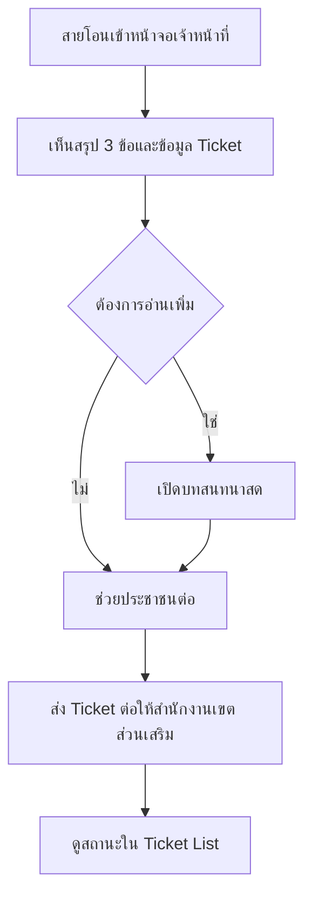
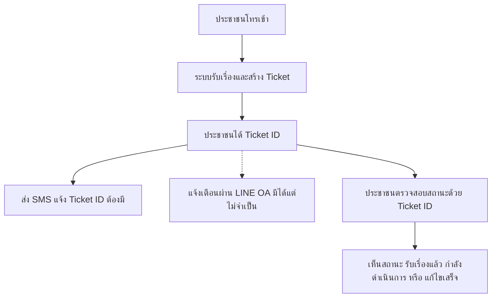

# User Flow: BKK CivicConnect AI

อ้างอิง: `intent-statement.md` (Intent Capture), `scope-document.md` และ `intent-backlog.md` (Scope Definition) และคำตอบใน `rough-mockups-questions.md` ([Q<n>] คือหมายเลขคำถามในไฟล์นั้น)

## ลำดับหลักของเจ้าหน้าที่ (Happy Path)

เจ้าหน้าที่ได้รับสายที่โอนมา เห็นสรุป 3 ข้อและข้อมูล Ticket ทันที เปิดบทสนทนาสดเมื่ออยากอ่านเพิ่ม แล้วตัดสินใจส่ง Ticket ต่อให้สำนักงานเขต (ส่วนเสริม) [Q3] [Q4]

ข้อความแทนแผนผัง: สายโอนเข้า เห็นสรุปและข้อมูล Ticket เปิดบทสนทนาสดถ้าต้องการ ช่วยประชาชน ส่ง Ticket ต่อ (ถ้ามี) แล้วดูสถานะในรายการ Ticket

## ลำดับของประชาชนเมื่อแจ้งปัญหา

ประชาชนโทรเข้ามา ระบบรับเรื่องและสร้าง Ticket ประชาชนได้ Ticket ID [Q1] และได้รับ SMS แจ้ง Ticket ID ซึ่งต้องมี ส่วนการแจ้งเตือนผ่าน LINE OA มีได้แต่ไม่จำเป็น [Q5]

ข้อความแทนแผนผัง: โทรเข้า สร้าง Ticket ได้ Ticket ID ส่ง SMS แจ้ง Ticket ID (ต้องมี) อาจแจ้งเตือนผ่าน LINE OA เพิ่ม (ไม่จำเป็น) แล้วตรวจสอบสถานะด้วย Ticket ID

## ลำดับการตรวจสอบสถานะ

- ประชาชนกรอก Ticket ID ในหน้าตรวจสอบสถานะบนมือถือ แล้วเห็นสถานะปัจจุบัน [Q1] [Q2] [Q6]
- เจ้าหน้าที่เปิดรายการ Ticket กรองตามสถานะ และเปิดดูรายละเอียด [Q1] [Q2]
- ค่าสถานะคือ รับเรื่องแล้ว, กำลังดำเนินการ, แก้ไขเสร็จ [Q9]

## จุดตัดสินใจและเส้นทางเมื่อผิดพลาด

- ถ้า Ticket ID ที่ประชาชนกรอกไม่พบ หน้าจอควรแจ้งว่าไม่พบ พร้อมให้กรอกใหม่ [assumption]
- ถ้าบทสนทนาสดไม่แสดง เจ้าหน้าที่ยังเห็นสรุปและข้อมูล Ticket ได้ [assumption]

## Assumptions & Open Questions

- ข้อความแจ้งเตือนเมื่อไม่พบ Ticket และเมื่อไม่มีบทสนทนาสดยังไม่ได้กำหนดถ้อยคำ [assumption]
