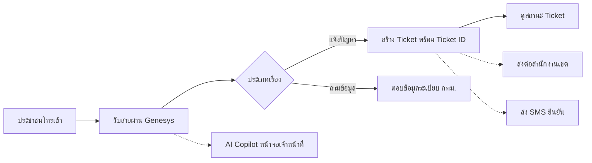

# Intent Backlog: BKK CivicConnect AI

อ้างอิง: `intent-statement.md` (Intent Capture), `feasibility-assessment.md`, `constraint-register.md` (Feasibility) และ `scope-definition-questions.md` ([Q<n>] คือหมายเลขคำถามในไฟล์นั้น) จัดลำดับด้วย MoSCoW และหลักลดความเสี่ยงก่อน [Q4] รายการเหล่านี้คือกลุ่มงานตั้งต้น (proto-Unit) ยังไม่ใช่การแบ่ง Unit สุดท้าย

## รายการงานเรียงตามลำดับทำ

| ลำดับ | กลุ่มงาน | MoSCoW | พึ่งพา | ลำดับตัด (1 = ตัดก่อน) | ที่มา |
|---|---|---|---|---|---|
| 1 | การรับสายผ่าน Genesys Cloud จริง และทดสอบเวลาตอบ 2 วินาที | Must | ไม่มี (ต้องเสร็จก่อนทุกอย่าง) | ไม่ตัด | [Q3] [Q4] |
| 2 | รับสายแจ้งปัญหาเมืองและสร้าง Ticket พร้อม Ticket ID | Must | ลำดับ 1 | ไม่ตัด | [Q1] |
| 3 | ดูและติดตามสถานะ Ticket | Must | ลำดับ 2 | ไม่ตัด | [Q1] [Q3] |
| 4 | รับสายถามข้อมูลระเบียบ กทม. และตอบกลับ | Must (ตัดได้) | ลำดับ 1 | 2 | [Q1] [Q8] [Q9] |
| 5 | AI Copilot บนหน้าจอเจ้าหน้าที่ | Could | ลำดับ 1 | ยังไม่ได้ตกลง | [Q5] |
| 6 | ปุ่มส่ง Ticket ต่อให้สำนักงานเขต | Could | ลำดับ 2 | ยังไม่ได้ตกลง | [Q2] |
| 7 | ส่งข้อความหรือ SMS ยืนยันให้ประชาชน | Could | ลำดับ 2 | 1 | [Q2] [Q8] |

## แผนผังสายธารคุณค่า (Value Stream)

เส้นประคือความสามารถที่มีก็ดี (Could)

ข้อความแทนแผนผัง: ประชาชนโทรเข้า รับสายผ่าน Genesys แล้วแยกเป็นแจ้งปัญหา (สร้าง Ticket แล้วดูสถานะ) หรือถามข้อมูล (ตอบข้อมูลระเบียบ กทม.) ส่วนส่งต่อสำนักงานเขต ส่ง SMS ยืนยัน และ AI Copilot เป็นส่วนเสริม

## Assumptions & Open Questions

- ลำดับการตัดของ AI Copilot และปุ่มส่งต่อสำนักงานเขตเทียบกับรายการอื่นยังไม่ได้ตกลง [assumption]
