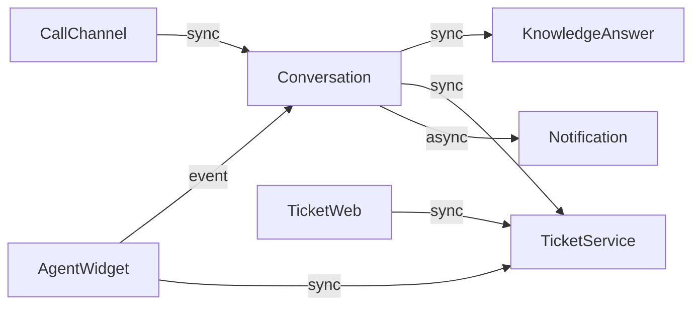

# Component Catalogue: BKK CivicConnect AI

อ้างอิง: `requirements.md` (Requirements Analysis), `stories.md` (User Stories), `team-practices.md` (Practices Discovery) และคำตอบใน `domain-design-questions.md` ([Q<n>] คือหมายเลขคำถามในไฟล์นั้น) ส่วนประกอบคือโค้ดที่ทีมต้องเขียนเอง ฐานข้อมูล บริการแปลงเสียง โมเดลภาษา และ Genesys Cloud เป็นสิ่งที่ส่วนประกอบเรียกใช้ ไม่นับเป็นส่วนประกอบ เอกสารนี้ไม่เลือกเทคโนโลยีและไม่กำหนดรูปแบบการติดตั้งใช้งาน

หมายเหตุการนับส่วนประกอบ: Q1 ตัวเลือก A กำหนด 6 ส่วนโดยรวมหน้าจอทั้งหมดเป็นส่วนเดียว ต่อมา Q5 ให้แยก Widget ที่ฝังใน Genesys ออกจากแอปเว็บของรายการ Ticket และหน้าตรวจสอบสถานะ ผลคือส่วน "เว็บ" แยกเป็น AgentWidget และ TicketWeb แคตตาล็อกนี้จึงมี **7 ส่วน** ตามคำตอบทั้งสองข้อ (ดู ADR-001 และ ADR-005 ใน `decisions.md`)

## Part A: แคตตาล็อกที่เครื่องอ่านได้

```yaml
components:
  - name: CallChannel
    summary: รับเหตุการณ์และเสียงของสายจาก Genesys Cloud และสั่งโอนสาย
    behaviour: >
      เป็นส่วนเดียวที่รู้จัก Genesys Cloud รับสายเข้า ส่งคำพูดที่ถอดได้ไปให้ Conversation
      และทำตามคำสั่งที่ Conversation ส่งกลับ (ตอบกลับประชาชน หรือโอนสายหาเจ้าหน้าที่)
      ส่งเบอร์ที่โทรเข้า (Caller ID) ต่อให้ Conversation เฉพาะเพื่อส่ง SMS และไม่เก็บเบอร์ไว้
    responsibilities:
      - รับสายและเหตุการณ์สายจาก Genesys Cloud
      - ส่งคำพูดที่ถอดได้ให้ Conversation
      - โอนสายหาเจ้าหน้าที่ตามคำสั่ง
    depends_on:
      - component: Conversation
        interaction: ส่งคำพูดของประชาชนเข้า และรับคำสั่งตอบกลับหรือโอนสาย
        style: sync
    dependents: []
    external_dependencies:
      - name: Genesys Cloud CX (org ark-insights)
        kind: third-party-api
        purpose: รับสาย โอนสาย และให้ข้อมูลเสียงของสาย
    entities: []

  - name: Conversation
    summary: ตัดสินใจว่าสายคือแจ้งปัญหาหรือถามข้อมูล สกัดข้อมูล ถามกลับ และสรุปสาย
    behaviour: >
      แยกประเภทสายเป็นแจ้งปัญหาหรือถามข้อมูล สกัดประเภทปัญหา สถานที่ และความเร่งด่วน (3 ระดับ) ถามกลับเรื่องสถานที่ 1 ครั้ง
      ถามซ้ำสูงสุด 2 ครั้งแล้วโอนสายเมื่อไม่เข้าใจ ถือว่าผลลัพธ์ AI ที่ผิดรูปแบบคือไม่เข้าใจ
      สร้างสรุป 3 ข้อของสายและเก็บไว้หลังสายจบ โดยไม่เก็บข้อความที่ประชาชนพูด
      ผลักบทสนทนาสดไปยัง AgentWidget
    responsibilities:
      - แยกประเภทสายและสกัดข้อมูลจากคำพูด
      - ควบคุมลำดับการถามกลับ ถามซ้ำ และโอนสาย
      - สร้างและเป็นเจ้าของสรุป 3 ข้อของสาย
      - สั่งสร้าง Ticket และสั่งส่ง SMS
    depends_on:
      - component: KnowledgeAnswer
        interaction: ขอคำตอบสำหรับคำถามข้อมูลระเบียบ กทม.
        style: sync
      - component: TicketService
        interaction: สั่งสร้าง Ticket เมื่อสกัดข้อมูลแจ้งปัญหาครบ
        style: sync
      - component: Notification
        interaction: สั่งส่ง SMS แจ้ง Ticket ID ไปยังเบอร์ที่โทรเข้า
        style: async
    dependents:
      - component: CallChannel
        interaction: ส่งคำพูดเข้า และรับคำสั่งตอบกลับหรือโอนสาย
      - component: AgentWidget
        interaction: รับสรุป 3 ข้อและบทสนทนาสดที่ผลักไปให้
    external_dependencies:
      - name: โมเดลภาษาไทย (รันภายในเครื่องของทีม)
        kind: other
        purpose: แยกประเภท สกัดข้อมูล และสรุป
      - name: บริการแปลงเสียงเป็นข้อความภาษาไทย (รันภายในเครื่องของทีม)
        kind: other
        purpose: ถอดคำพูดของประชาชน
    entities:
      - name: Conversation
        identifier: conversationId
        attributes: [genesysInteractionId, callType, summaryPoints, callStatus, startedAt, endedAt]

  - name: KnowledgeAnswer
    summary: ตอบคำถามระเบียบ กทม. เฉพาะที่อยู่ในชุดข้อมูลตัวอย่าง
    behaviour: >
      ค้นคำตอบจากชุดข้อมูลตัวอย่าง (Mock Civic Dataset) เท่านั้น ถ้าไม่พบให้ส่งผลว่าไม่มีข้อมูล
      เพื่อให้ Conversation บอกประชาชนตรงๆ และเสนอโอนสาย ไม่ตอบจากความรู้ทั่วไป
      ส่วนนี้ตัดได้เป็นอันดับที่ 2 เมื่อเวลาไม่พอ
    responsibilities:
      - ค้นและตอบจากชุดข้อมูลตัวอย่าง
      - รายงานเมื่อไม่พบคำตอบ
    depends_on: []
    dependents:
      - component: Conversation
        interaction: ขอคำตอบสำหรับคำถามข้อมูลระเบียบ กทม.
    external_dependencies:
      - name: ชุดข้อมูลระเบียบ กทม. ตัวอย่าง (Mock Civic Dataset)
        kind: other
        purpose: แหล่งคำตอบ
    entities:
      - name: KnowledgeEntry
        identifier: entryId
        attributes: [topic, question, answer]

  - name: TicketService
    summary: เป็นเจ้าของ Ticket สถานะ และการออก Ticket ID
    behaviour: >
      สร้าง Ticket ที่มีประเภท สถานที่ ความเร่งด่วน ข้อความสรุป เวลาที่แจ้ง สถานะ และหน่วยงานรับผิดชอบ
      ออก Ticket ID รูปแบบ BKK-2026-XXXX ไม่เก็บข้อความที่ประชาชนพูดและไม่เก็บเบอร์โทร
      ให้ดูรายการ กรองตามสถานะและเขต ดูสถานะด้วย Ticket ID และเปลี่ยนสถานะ (รับเรื่องแล้ว กำลังดำเนินการ แก้ไขเสร็จ)
      ทำเครื่องหมายส่งต่อให้สำนักงานเขต (ส่วนมีก็ดี)
    responsibilities:
      - สร้าง จัดเก็บ และออก Ticket ID
      - จัดการสถานะและการส่งต่อ
      - ตอบการค้นรายการและการค้นด้วย Ticket ID
    depends_on: []
    dependents:
      - component: Conversation
        interaction: สั่งสร้าง Ticket
      - component: AgentWidget
        interaction: อ่านข้อมูล Ticket และสั่งส่งต่อให้สำนักงานเขต
      - component: TicketWeb
        interaction: แสดงรายการ ตรวจสอบสถานะ และเปลี่ยนสถานะ
    external_dependencies:
      - name: ที่เก็บ Ticket แบบ JSON Store
        kind: database
        purpose: เก็บ Ticket
    entities:
      - name: Ticket
        identifier: ticketId
        attributes: [category, street, district, severity, aiSummaryText, reportedAt, status, responsibleAgency, forwardedToDistrict, conversationId]
        references:
          - entity: Conversation
            owned_by: Conversation
            relationship: "Ticket แต่ละใบอ้างอิงการสนทนาที่ทำให้เกิด Ticket หนึ่งรายการ"

  - name: Notification
    summary: ส่งข้อความแจ้ง Ticket ID ให้ผู้แจ้ง
    behaviour: >
      ส่ง SMS แจ้ง Ticket ID ไปยังเบอร์ที่ได้รับ (ต้องมี) และส่งผ่าน LINE OA เพิ่มได้ (ไม่จำเป็น)
      ไม่เก็บเบอร์โทรหลังส่ง ถ้าไม่มีเบอร์ให้ข้ามการส่งโดยไม่กระทบ Ticket
      ส่วนนี้ตัดได้เมื่อเวลาไม่พอ แต่ SMS เป็นข้อกำหนดที่ต้องมีตาม FR3
    responsibilities:
      - ส่ง SMS และ (ถ้ามี) LINE OA
      - ไม่เก็บเบอร์โทรของผู้แจ้ง
    depends_on: []
    dependents:
      - component: Conversation
        interaction: สั่งส่งข้อความแจ้ง Ticket ID
    external_dependencies:
      - name: ช่องทางส่ง SMS (ยังไม่ได้เลือก)
        kind: third-party-api
        purpose: ส่ง SMS
      - name: LINE OA (ส่วนเสริม)
        kind: third-party-api
        purpose: แจ้งเตือนเพิ่มเติม
    entities: []

  - name: AgentWidget
    summary: Widget ที่ฝังใน Genesys Agent Workspace แสดงสรุปและข้อมูล Ticket
    behaviour: >
      แสดงสรุป 3 ข้อและข้อมูล Ticket ที่ส่วนบนสุด เปิดบทสนทนาสดดูเพิ่มได้ และมีปุ่มส่งต่อให้สำนักงานเขต
      รับข้อมูลที่ Conversation ผลักมา ถ้าตัด AI Copilot เหลือเฉพาะข้อมูล Ticket ส่วนนี้เป็นส่วนมีก็ดี
    responsibilities:
      - แสดงสรุป ข้อมูล Ticket และบทสนทนาสดต่อเจ้าหน้าที่
    depends_on:
      - component: Conversation
        interaction: รับสรุป 3 ข้อและบทสนทนาสดที่ผลักมา
        style: event
      - component: TicketService
        interaction: อ่านข้อมูล Ticket และสั่งส่งต่อให้สำนักงานเขต
        style: sync
    dependents: []
    external_dependencies:
      - name: Genesys Agent Workspace (พื้นที่ฝัง Widget)
        kind: third-party-api
        purpose: แสดง Widget ให้เจ้าหน้าที่
    entities: []

  - name: TicketWeb
    summary: แอปเว็บของรายการ Ticket และหน้าตรวจสอบสถานะ
    behaviour: >
      หน้ารายการและรายละเอียด Ticket สำหรับเจ้าหน้าที่ศูนย์และเจ้าหน้าที่เขต (กรองตามสถานะและเขต) พร้อมเปลี่ยนสถานะ
      และหน้าตรวจสอบสถานะด้วย Ticket ID สำหรับประชาชนบนมือถือ
    responsibilities:
      - แสดงรายการ รายละเอียด และสถานะ Ticket
      - รับการเปลี่ยนสถานะจากเจ้าหน้าที่
      - ตรวจสอบสถานะด้วย Ticket ID สำหรับประชาชน
    depends_on:
      - component: TicketService
        interaction: อ่านและเปลี่ยนข้อมูล Ticket
        style: sync
    dependents: []
    external_dependencies: []
    entities: []
```

## Part B: มุมมองสำหรับคนอ่าน

### Component Diagram



ข้อความแทนแผนผัง: CallChannel เรียก Conversation, Conversation เรียก KnowledgeAnswer และ TicketService และสั่ง Notification แบบไม่รอ, AgentWidget รับเหตุการณ์จาก Conversation และอ่านจาก TicketService, TicketWeb อ่านและเปลี่ยนข้อมูลผ่าน TicketService

### Component Summary

| Component | Purpose | Depends On | Dependents | Entities Owned |
|---|---|---|---|---|
| CallChannel | รับสายและโอนสายผ่าน Genesys | Conversation | ไม่มี | ไม่มี |
| Conversation | แยกประเภท สกัดข้อมูล ถามกลับ สรุปสาย | KnowledgeAnswer, TicketService, Notification | CallChannel, AgentWidget | Conversation |
| KnowledgeAnswer | ตอบข้อมูลระเบียบจากชุดข้อมูลตัวอย่าง | ไม่มี | Conversation | KnowledgeEntry |
| TicketService | เป็นเจ้าของ Ticket และสถานะ | ไม่มี | Conversation, AgentWidget, TicketWeb | Ticket |
| Notification | ส่ง SMS และ LINE OA | ไม่มี | Conversation | ไม่มี |
| AgentWidget | Widget ของเจ้าหน้าที่ใน Genesys | Conversation, TicketService | ไม่มี | ไม่มี |
| TicketWeb | รายการ Ticket และหน้าตรวจสอบสถานะ | TicketService | ไม่มี | ไม่มี |

### Entity Ownership

| Entity | Owning Component | Identifier | Attributes | References |
|---|---|---|---|---|
| Conversation | Conversation | conversationId | genesysInteractionId, callType, summaryPoints, callStatus, startedAt, endedAt | ไม่มี |
| Ticket | TicketService | ticketId | category, street, district, severity, aiSummaryText, reportedAt, status, responsibleAgency, forwardedToDistrict, conversationId | Conversation (Conversation) |
| KnowledgeEntry | KnowledgeAnswer | entryId | topic, question, answer | ไม่มี |

### External Dependencies

| Component | Dependency | Kind | Purpose |
|---|---|---|---|
| CallChannel | Genesys Cloud CX (org ark-insights) | third-party-api | รับสาย โอนสาย |
| Conversation | โมเดลภาษาไทย (รันภายในเครื่อง) | other | แยกประเภท สกัดข้อมูล สรุป |
| Conversation | บริการแปลงเสียงเป็นข้อความ (รันภายในเครื่อง) | other | ถอดคำพูด |
| KnowledgeAnswer | ชุดข้อมูลระเบียบตัวอย่าง | other | แหล่งคำตอบ |
| TicketService | ที่เก็บ Ticket แบบ JSON Store | database | เก็บ Ticket |
| Notification | ช่องทางส่ง SMS (ยังไม่ได้เลือก) | third-party-api | ส่ง SMS |
| Notification | LINE OA (ส่วนเสริม) | third-party-api | แจ้งเตือนเพิ่มเติม |
| AgentWidget | Genesys Agent Workspace | third-party-api | พื้นที่ฝัง Widget |

### Rationale

| Component | เหตุผลที่แยกเป็นส่วนของตัวเอง |
|---|---|
| CallChannel | แยกความรู้เรื่อง Genesys ไว้ที่เดียว เปลี่ยนแปลงตามแพลตฟอร์มโทรศัพท์ |
| Conversation | มีตรรกะบทสนทนาและเป็นเจ้าของข้อมูลการสนทนา เปลี่ยนบ่อยตามคำพูดและโมเดล |
| KnowledgeAnswer | ตัดได้เป็นอันดับที่ 2 และมีแหล่งข้อมูลของตัวเอง |
| TicketService | เป็นเจ้าของ Ticket ที่หลายส่วนใช้ อายุของข้อมูลยาวกว่าสาย |
| Notification | ตัดได้และพึ่งบริการภายนอกที่ยังไม่ได้เลือก |
| AgentWidget | ฝังใน Genesys ต้องการรูปแบบการติดตั้งของตัวเอง และเป็นส่วนมีก็ดี |
| TicketWeb | ผู้ใช้ต่างกลุ่ม (เจ้าหน้าที่และประชาชน) อยู่นอก Genesys |

**ทางเลือกที่ไม่ได้เลือก (Alternatives Rejected):** แบบหยาบ 3 ส่วน (VoiceFlow, TicketService, Web) ไม่ได้เลือก เพราะ VoiceFlow ใหญ่ ตัดส่วนที่ตัดได้ยาก และทดสอบแยกยากกว่า [Q1] ทางเลือกที่ใส่สรุป 3 ข้อไว้ใน Ticket ไม่ได้เลือก เพราะสายที่ไม่มี Ticket จะไม่มีสรุปให้ Widget [Q2]

## Assumptions & Open Questions

- ชื่อส่วนประกอบและชื่อข้อมูลเป็นร่างแรกของผม ใช้ภาษาอังกฤษแบบ PascalCase ตามแม่แบบ ยังไม่ผ่านการยืนยันถ้อยคำ [assumption]
- ช่องทางส่ง SMS ยังไม่ได้เลือก และยังไม่ได้ตัดสินว่า Genesys ส่ง SMS ให้ได้หรือไม่ [assumption]
- ที่เก็บ Ticket เป็น JSON Store ตาม Feasibility ยังไม่ได้ตัดสินเรื่องการเข้าถึงพร้อมกันหลายคน (รายการ Ticket เปลี่ยนสถานะพร้อมกัน) [assumption]
- หัวข้อของชุดข้อมูลระเบียบ กทม. ยังไม่กำหนด (คำถามค้างจาก Requirements Analysis) จึงกำหนดได้เพียงรูปร่างของ KnowledgeEntry
- ทิศทางการอ้างอิง Ticket กับ Conversation ใช้ทิศทางเดียว (Ticket อ้างถึง Conversation) และ Conversation หา Ticket ของสายตนด้วยการค้นย้อนกลับ [assumption]
