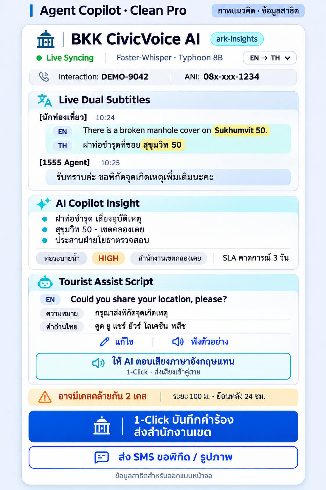
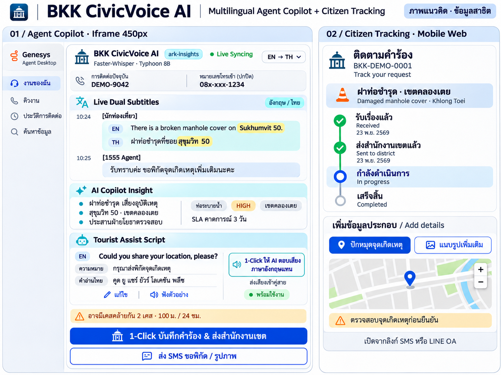
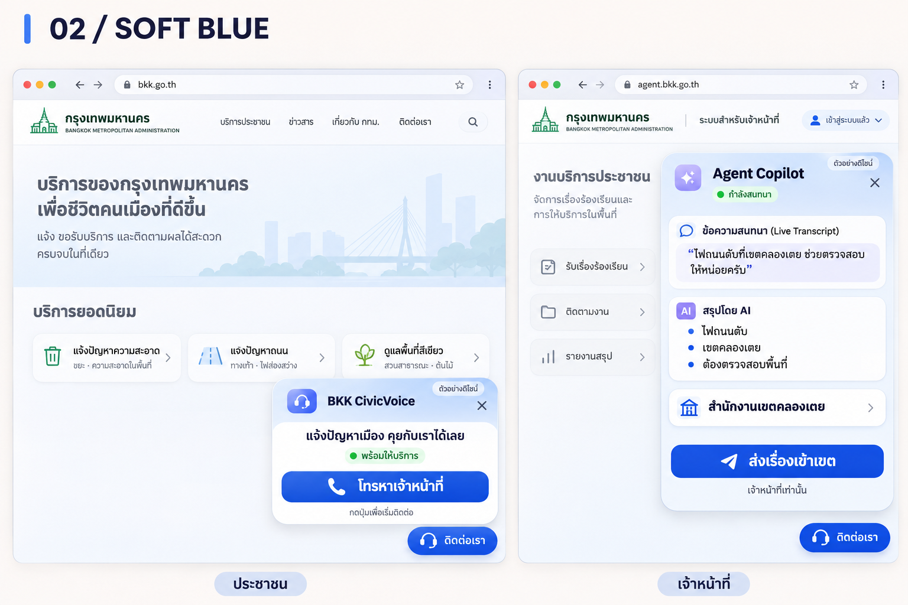

# Widget design concepts

**ภาพ Widget ล่าสุด — Clean Pro:** `designs/06-agent-copilot-widget-clean-pro.png` เป็นภาพแนวตั้งเน้น Agent Copilot iframe หนึ่งคอลัมน์ แสดง Dual Subtitles, AI Insight, Tourist Assist, English TTS, Duplicate Notice และปุ่ม Dispatch/SMS ใช้ภาพ 05 เป็น style reference และบันทึก prompt ใน `generation-prompts-v4.json` ข้อมูลและสถานะในภาพเป็นสาธิต

**ภาพรวม Copilot + Tracking — Multilingual Tourist Assist:** `designs/05-multilingual-agent-copilot-clean-pro.png` แสดงซับ EN/TH คู่กัน, สคริปต์อังกฤษพร้อมความหมายและคำอ่านไทย, ปุ่มฟังตัวอย่างและส่ง English TTS เข้าคู่สาย พร้อม Citizen Tracking ในธีม Clean Pro / Soft Blue ภาพเป็นแนวคิด ข้อมูลและสถานะเป็นสาธิต ไม่ใช่ระบบที่เชื่อมต่อแล้ว ดู `tourist-assist-plan.md` สำหรับพฤติกรรมและเกณฑ์ตรวจ

สร้างด้วย built-in image_gen โดยใช้ภาพ 04 เป็น style reference บันทึก prompt ฉบับเต็มและไฟล์ต้นทางใน `generation-prompts-v3.json`

**อัปเดตจากบรีฟล่าสุด:** ใช้ Agent Copilot iframe 400–500px เป็นหน้าหลัก และ Citizen Tracking Web เป็นหน้าเสริม โดยคงแนว Clean Pro ขาว–น้ำเงินจาก Soft Blue ภาพ 04 ด้านล่างเป็นรุ่นก่อนเพิ่ม Tourist Assist ส่วนภาพล่าสุดคือ 05 และแผนที่ใช้ปัจจุบันคือ `agent-copilot-tracking-plan-v2.md` พร้อม `tourist-assist-plan.md` ข้อความ popup/AI-first UI ด้านล่างเป็นบันทึกแนวคิดเดิม ไม่ใช่ขอบเขตหน้าจอที่ใช้พัฒนาในบรีฟล่าสุด

**ดีไซน์ที่เลือก: 02 Soft Blue** — ผู้ใช้ยืนยันวันที่ 23 พฤศจิกายน 2026 ให้ใช้ขาว–น้ำเงิน ดู modern และเป็นมิตร เพราะเข้ากับเว็บไซต์อื่นได้ง่าย ใช้เป็นแนวทางสำหรับ popup ประชาชนและ Agent Copilot บน branch `feature/fe-widget`

**คำชี้แจง flow ล่าสุด:** popup หลักใช้คุยกับ AI Voice ซึ่งตอบจากข้อมูลที่ทีมเตรียมไว้ หลังคุยเสร็จแสดงสรุปให้ตรวจสอบแล้วกดส่งเรื่องเข้าเขตได้ เจ้าหน้าที่มนุษย์เป็นทางส่งต่อเมื่อจำเป็น ไม่ใช่ผู้รับสายหลัก ข้อกำหนดพฤติกรรมนี้ใช้แทนข้อความและการแบ่งหน้าจอในภาพแนวคิดเดิม

สร้างด้วย built-in image_gen วันที่ 23 พฤศจิกายน 2026 เป็นภาพแนวคิด 3 แบบแยกไฟล์ ข้อมูลและสถานะสายเป็นตัวอย่าง เว็บไซต์/ตราสัญลักษณ์ในภาพเป็นองค์ประกอบประกอบแนวคิด ไม่ใช่การยืนยันแบรนด์หรือ deployment จริง

ทุกภาพวางเว็บไซต์ฝั่งประชาชนทางซ้ายและฝั่งเจ้าหน้าที่ทางขวา เพื่อเทียบ launcher มุมขวาล่าง, popup, ปุ่มโทร และข้อมูลช่วยเจ้าหน้าที่ ตัวอย่าง Agent ในภาพเป็น standalone host; เมื่อฝังใน Genesys ให้ใช้เต็มกรอบ iframe ตามแผน

| แบบ | ลักษณะ | เหมาะกับ |
|---|---|---|
| 01 Civic Minimal | ขาว/เขียว ปุ่มใหญ่ ช่องว่างชัด เนื้อหาสั้น | ตัวอย่างประกอบ |
| **02 Soft Blue — เลือกใช้** | ขาว/น้ำเงิน การ์ดโค้งและสีอ่อน แยกเนื้อหาเป็นส่วน | หน้าตา modern เป็นมิตร เข้ากับเว็บไซต์อื่นได้ง่าย |
| 03 Night Console | พื้นเข้ม/teal ข้อมูลแบ่งชั้นชัด | ทางเลือกธีมหน้าจอเจ้าหน้าที่ |

## 01 — Civic Minimal

แนวคิดเดิมสำหรับเปรียบเทียบ ภาพไม่ได้อยู่ในชุดไฟล์ปัจจุบัน

## 02 — Soft Blue (ดีไซน์ที่เลือก)

## 03 — Night Console

แนวคิดเดิมสำหรับเปรียบเทียบ ภาพไม่ได้อยู่ในชุดไฟล์ปัจจุบัน

## พฤติกรรมที่ต้องเพิ่มในการพัฒนา

- ภาพเดิมใช้อ้างอิงสี/รูปทรงของ Soft Blue; เปลี่ยนปุ่ม “โทรหาเจ้าหน้าที่” เป็น “เริ่มคุยกับ AI” และเพิ่มสถานะ AI กำลังฟัง/ประมวลผล/ตอบ
- เพิ่มลำดับหลังคุย: กำลังสรุป → แสดงสรุปและเขตให้ตรวจ → ส่งเรื่องเข้าเขต → ผลการส่ง/เลขเรื่อง โดย inquiry ที่ตอบข้อมูลจบไม่จำเป็นต้องส่งเขต
- หน้าจอจริงต้องมี microphone permission, connecting, conversation ended, summary pending และ error states; queued ใช้เมื่อมีการรอจริง
- แสดงพร้อมให้บริการหรือกำลังสนทนาเมื่อได้รับสถานะจริงเท่านั้น
- ปุ่มโทรเริ่มการสนทนากับ AI Voice ผ่านไมโครโฟนบนเว็บไซต์ตามที่ผู้ใช้เลือก ไม่ใช้ `tel:` แทน
- แสดงบทสนทนา/สรุปและปุ่มส่งเรื่องเฉพาะ session ของผู้ใช้รายนั้น; ข้อมูลและคำสั่งของเจ้าหน้าที่คงอยู่ใน Agent Copilot ตามสิทธิ์
- AI ตอบจากชุดข้อมูลที่เตรียมไว้ หากไม่มีคำตอบให้แจ้งตรงๆ และเสนอส่งต่อมนุษย์ตามเอกสาร
- ปุ่มส่งเรื่องยืนยันผลจาก Backend และปลายทางตามความสามารถจริง ไม่ใช้ success alert แบบตายตัว
- Font/contrast และขนาดแตะในภาพยังไม่ใช่ผลตรวจ accessibility ต้องวัดเมื่อทำเป็น HTML/CSS

บันทึก prompt ฉบับเต็มและข้อมูลไฟล์ต้นทางอยู่ใน `generation-prompts.json` ภาพถูกคัดลอกเข้า repository และคงไฟล์ต้นฉบับจากตัวสร้างไว้
