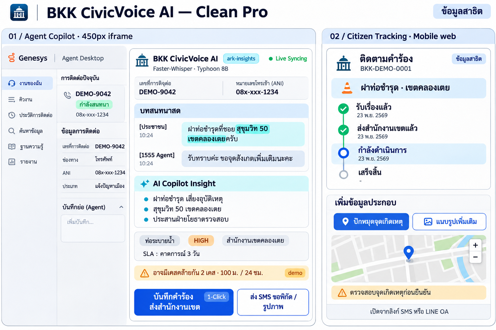

# Widget design concepts

**ต้นแบบล่าสุดที่รันจากโค้ด:** ป๊อปอัป AI Voice อยู่บนเว็บประชาชนมุมขวาล่าง สรุปด้วยการ์ดรูปแบบเดียวกับ Agent Copilot และเปิดฟอร์มขอ SMS หลังยืนยันคำร้อง Agent Copilot ใช้ iframe ของเจ้าหน้าที่ ดู [Frontend Style Guide](../../../../../../../../docs/frontend-style-guide.md) และภาพต้นแบบ [Citizen SMS](designs/09-citizen-sms-browser-demo.png), [Agent Copilot](designs/07-agent-copilot-browser-demo.png) และ [Citizen Tracking](designs/08-citizen-tracking-browser-demo.png)

## ภาพแนวคิดที่ใช้อ้างอิง

**แนวคิด Agent Copilot — Clean Pro:** `designs/06-agent-copilot-widget-clean-pro.png` เป็นภาพแนวตั้งเน้น Agent Copilot iframe หนึ่งคอลัมน์ แสดง Dual Subtitles, AI Insight, Tourist Assist, English TTS, Duplicate Notice และปุ่ม Dispatch/SMS ใช้ภาพ 05 เป็น style reference และบันทึก prompt ใน `generation-prompts-v4.json` ข้อมูลและสถานะในภาพเป็นสาธิต

**ภาพรวม Copilot + Tracking — Multilingual Tourist Assist:** `designs/05-multilingual-agent-copilot-clean-pro.png` แสดงซับ EN/TH คู่กัน, สคริปต์อังกฤษพร้อมความหมายและคำอ่านไทย, ปุ่มฟังตัวอย่างและส่ง English TTS เข้าคู่สาย พร้อม Citizen Tracking ในธีม Clean Pro / Soft Blue ภาพเป็นแนวคิด ข้อมูลและสถานะเป็นสาธิต ไม่ใช่ระบบที่เชื่อมต่อแล้ว ดู `tourist-assist-plan.md` สำหรับพฤติกรรมและเกณฑ์ตรวจ

สร้างด้วย built-in image_gen โดยใช้ภาพ 04 เป็น style reference บันทึก prompt ฉบับเต็มและไฟล์ต้นทางใน `generation-prompts-v3.json`

ภาพ 04 เป็นแนวคิดก่อนเพิ่ม Tourist Assist ใช้ Agent Copilot iframe 400–500px และ Citizen Tracking Web โดยคงแนว Clean Pro ขาว–น้ำเงินจาก Soft Blue

**ดีไซน์ที่เลือก: 02 Soft Blue** — ผู้ใช้ยืนยันวันที่ 23 พฤศจิกายน 2026 ให้ใช้ขาว–น้ำเงิน ดู modern และเป็นมิตร เพราะเข้ากับเว็บไซต์อื่นได้ง่าย ใช้เป็นแนวทางสำหรับ popup ประชาชนและ Agent Copilot บน branch `feature/fe-widget`

ต้นแบบใช้ข้อความ **เริ่มสนทนา** ในป๊อปอัปประชาชน ผู้ใช้ตรวจสรุปและกด **ยืนยันแจ้งปัญหา** เพื่อรับเลขคำร้อง เจ้าหน้าที่กดส่งสำนักงานเขตใน Agent Copilot

สร้างด้วย built-in image_gen วันที่ 23 พฤศจิกายน 2026 เป็นภาพแนวคิด 3 แบบแยกไฟล์ ข้อมูลและสถานะสายเป็นตัวอย่าง เว็บไซต์/ตราสัญลักษณ์ในภาพเป็นองค์ประกอบประกอบแนวคิด ไม่ใช่การยืนยันแบรนด์หรือ deployment จริง

ทุกภาพวางเว็บไซต์ฝั่งประชาชนทางซ้ายและฝั่งเจ้าหน้าที่ทางขวา เพื่อเทียบ launcher มุมขวาล่าง, popup, ปุ่มโทร และข้อมูลช่วยเจ้าหน้าที่ ตัวอย่าง Agent ในภาพเป็น standalone host; เมื่อฝังใน Genesys ให้ใช้เต็มกรอบ iframe ตามแผน

| แบบ | ลักษณะ | เหมาะกับ |
|---|---|---|
| 01 Civic Minimal | ขาว/เขียว ปุ่มใหญ่ ช่องว่างชัด เนื้อหาสั้น | ตัวอย่างประกอบ |
| **02 Soft Blue — เลือกใช้** | ขาว/น้ำเงิน การ์ดโค้งและสีอ่อน แยกเนื้อหาเป็นส่วน | หน้าตา modern เป็นมิตร เข้ากับเว็บไซต์อื่นได้ง่าย |
| 03 Night Console | พื้นเข้ม/teal ข้อมูลแบ่งชั้นชัด | ทางเลือกธีมหน้าจอเจ้าหน้าที่ |

## 01 — Civic Minimal

แนวคิดเดิมสำหรับเปรียบเทียบ ภาพไม่ได้อยู่ในชุดไฟล์ปัจจุบัน

## 02 — Soft Blue (ดีไซน์ที่เลือก)

## 03 — Night Console

แนวคิดเดิมสำหรับเปรียบเทียบ ภาพไม่ได้อยู่ในชุดไฟล์ปัจจุบัน

บันทึก prompt ฉบับเต็มและข้อมูลไฟล์ต้นทางอยู่ใน `generation-prompts.json` ภาพถูกคัดลอกเข้า repository และคงไฟล์ต้นฉบับจากตัวสร้างไว้
