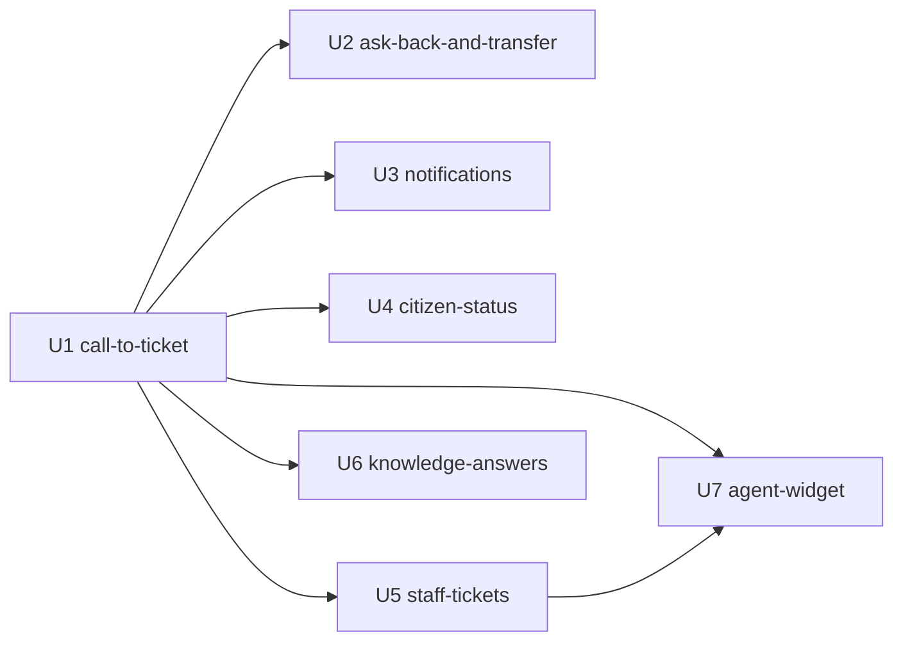

# Unit Dependency: BKK CivicConnect AI

อ้างอิง: `components.md` และ `decisions.md` (Domain Design), `requirements.md`, `stories.md`, `unit-of-work.md` และคำตอบใน `units-generation-questions.md` ([Q<n>] คือหมายเลขคำถามในไฟล์นั้น) เอกสารนี้อธิบายเพียงว่า Unit ใดพึ่งพา Unit ใด (โครงสร้าง) ไม่แนะนำลำดับการสร้างและไม่ระบุเส้นทางสำคัญ ซึ่งเป็นการตัดสินใจของ Delivery Planning

## เส้นพึ่งพา (DAG)

"A พึ่ง B" หมายถึง โค้ดหรือการทดสอบของ A ต้องใช้โค้ดของ B จึงจะสร้างและผ่านได้

| Unit | พึ่ง |
|---|---|
| U1 u1-call-to-ticket | ไม่มี |
| U2 u2-ask-back-and-transfer | U1 |
| U3 u3-notifications | U1 |
| U4 u4-citizen-status | U1 |
| U5 u5-staff-tickets | U1 |
| U6 u6-knowledge-answers | U1 |
| U7 u7-agent-widget | U1, U5 |

เหตุผลของ U7 พึ่ง U5: ปุ่มส่งต่อให้สำนักงานเขตใน Widget ใช้ความสามารถทำเครื่องหมายส่งต่อที่ U5 สร้าง [unit-of-work.md]



ข้อความแทนแผนผัง: U1 ไม่พึ่งใคร U2, U3, U4, U5 และ U6 พึ่ง U1 และ U7 พึ่ง U1 กับ U5

## จุดเชื่อมต่อระหว่าง Unit

| ระหว่าง | จุดเชื่อมต่อ | ที่มา |
|---|---|---|
| U1 กับทุก Unit ที่เหลือ | การสร้าง Ticket การออก Ticket ID และข้อมูลการสนทนา (สัญญากำหนดใน Contract Design) | components.md |
| U3 กับ U1 | Conversation สั่ง Notification ส่งข้อความ โดยส่งเบอร์ที่โทรเข้าผ่านเส้นทางเดียวและไม่เก็บ | ADR-007 |
| U4, U5 กับ U1 | อ่านและเปลี่ยนข้อมูล Ticket ผ่าน TicketService | components.md |
| U6 กับ U1 | Conversation เรียก KnowledgeAnswer และรับผลว่ามีหรือไม่มีคำตอบ | components.md |
| U7 กับ U1, U5 | Widget รับข้อมูลที่ Conversation ผลักมา อ่านข้อมูล Ticket และสั่งส่งต่อผ่าน TicketService | ADR-004 |

## โอกาสสร้างขนานกัน

เมื่อ U1 เสร็จ U2, U3, U4, U5 และ U6 ไม่มีเส้นพึ่งพากัน จึงสร้างพร้อมกันได้ตามจำนวนคนในทีม [Q3] U7 ต้องรอ U5 เพราะพึ่ง U5

แต่ละ Unit ที่สร้างพร้อมกันอยู่ในสำเนาโปรเจกต์ของตัวเอง โดยไม่มีงานของ Unit อื่นอยู่ในนั้น ดังนั้นโค้ดและการทดสอบของแต่ละ Unit ต้องผ่านได้ด้วยโค้ดของตัวเอง ของ Unit ที่ตนพึ่ง และโปรเจกต์ตามที่เป็นอยู่

## ชิ้นงานบางๆ ที่รันครบทาง (walking skeleton)

Unit แรกใน DAG ที่ไม่พึ่งใครคือ U1 ซึ่งเป็นชิ้นงานที่รันครบทาง คือรับสายจริง สร้าง Ticket และเห็น Ticket ID ได้ก่อน Unit อื่น เพราะ U2 ถึง U7 ต่อยอดจาก U1 [team-practices.md] เครื่องหมายใน `bolt-plan.md` ไม่เปลี่ยนลำดับ DAG ตามรันไทม์

## Edge block

```yaml
units:
  - name: u1-call-to-ticket
    kind: service
    depends_on: []
  - name: u2-ask-back-and-transfer
    kind: service
    depends_on: [u1-call-to-ticket]
  - name: u3-notifications
    kind: service
    depends_on: [u1-call-to-ticket]
  - name: u4-citizen-status
    kind: ui
    depends_on: [u1-call-to-ticket]
  - name: u5-staff-tickets
    kind: ui
    depends_on: [u1-call-to-ticket]
  - name: u6-knowledge-answers
    kind: service
    depends_on: [u1-call-to-ticket]
  - name: u7-agent-widget
    kind: ui
    depends_on: [u1-call-to-ticket, u5-staff-tickets]
```

## Assumptions & Open Questions

- สัญญาระหว่าง Unit (รูปแบบข้อมูลและพฤติกรรมเมื่อล้มเหลว) ยังไม่ได้กำหนด จะกำหนดใน Contract Design [assumption]
- การที่ U4 และ U5 พึ่ง U1 เพียงอย่างเดียว สมมติว่าการอ่านและเปลี่ยน Ticket ทดสอบได้ด้วย Ticket ที่ U1 สร้าง หรือข้อมูลตัวอย่างใน Ticket store [assumption]
