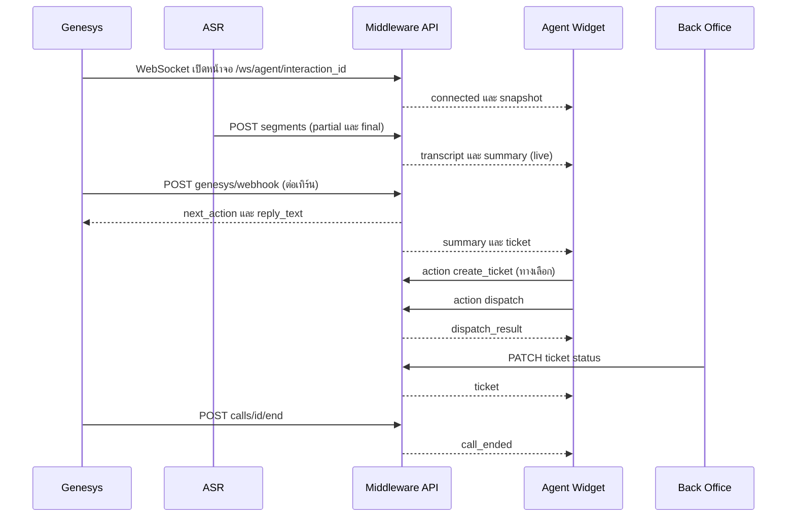

# BKK CivicVoice AI: คู่มือการใช้งาน API

เอกสารนี้สำหรับทีมที่ต้องเรียกใช้ Middleware API ได้แก่ Genesys Cloud CX (Watchara), Agent Widget (Aitthiphon), ผู้ส่งต่อข้อมูล ASR, ระบบหลังบ้านของสำนักงานเขต และทีม Demo

> **แหล่งที่มาของตัวอย่าง:** ตัวอย่าง request/response ทั้งหมดในเอกสารนี้ได้จากการรันแอปจริง **พร้อม LLM เปิดใช้งาน** (`typhoon-8b` บน vLLM DGX 101) เมื่อวันที่ 25 พ.ย. 2026 ใช้ in-memory database เพื่อไม่ให้กระทบข้อมูลจริง ชุดเทส `pytest` ผ่านทั้งหมดก่อนการรันนี้
>
> ค่าบางอย่างเช่นเวลา รหัส Ticket และเนื้อหาสรุปจาก LLM จะต่างไปในแต่ละการรัน ให้ยึดโครงสร้างฟิลด์เป็นหลัก

---

## 1. ภาพรวม

Middleware นี้ทำหน้าที่รับเสียงพูดที่ถอดเป็นข้อความแล้ว (จาก Genesys / ASR) วิเคราะห์เจตนาด้วย Thai LLM (Typhoon ผ่าน vLLM) และ Civic RAG จากนั้นสร้าง Ticket หรือตอบคำถามประชาชน และกระจายเหตุการณ์สดไปยัง Agent Widget ผ่าน WebSocket

| สภาพแวดล้อม | Base URL |
|---|---|
| Local (พัฒนา) | `http://localhost:8000` |
| Production (Demo) | `https://voiceai-demo.ark-insights.com` |

เอกสารแบบ interactive (สร้างอัตโนมัติจาก FastAPI):

| URL | ใช้ทำอะไร |
|---|---|
| `/docs` | Swagger UI สำหรับลองยิง API ในเบราว์เซอร์ |
| `/redoc` | เอกสารแบบอ่านอย่างเดียว |
| `/openapi.json` | ไฟล์ OpenAPI schema สำหรับ import เข้า Postman หรือเครื่องมืออื่น (ไฟล์ตัวอย่างอยู่ที่ `docs/openapi.json`) |

ตรวจสถานะและเวอร์ชันของระบบได้ที่ `GET /` (ดูหัวข้อ 5.1)

---

## 2. การยืนยันตัวตน (Auth)

**ยังไม่มีการยืนยันตัวตน** ทุก endpoint และ WebSocket เปิดให้เรียกได้ทันทีภายในเครือข่าย จึงต้องเรียกจากเครือข่ายภายในเท่านั้น

ข้อเสนอสำหรับการเพิ่มในอนาคต (ยังไม่ได้ implement)
- Webhook และ REST: ใช้ shared-secret header เช่น `X-API-Key`
- WebSocket: ใช้ token ใน query string เช่น `?token=...`

---

## 3. ข้อตกลงทั่วไป (Conventions)

| หัวข้อ | รายละเอียด |
|---|---|
| Content-Type | `application/json` และเข้ารหัส UTF-8 (รองรับภาษาไทยเต็มรูปแบบ) |
| เวลา | ISO 8601 เวลาท้องถิ่นไม่มี timezone เช่น `2026-11-25T14:22:42` |
| รหัส Ticket | รูปแบบ `BKK-{ปี}-{เลข 4 หลัก}` เช่น `BKK-2026-0001` (อ่านออกเสียงเป็น `BKK 2026 0001`) |
| รหัสสาย | `interaction_id` มาจาก Genesys Conversation ID ใช้เป็นตัวระบุหนึ่งสายโทร |
| Error (ข้อความ) | FastAPI ส่ง `{"detail": ...}` ข้อความบางส่วนเป็นภาษาไทย บางส่วนเป็นอังกฤษ |
| Validation (422) | ค่าที่ส่งผิด schema หรือ enum ไม่ถูกต้อง |
| ไม่พบข้อมูล (404) | เช่น Ticket ที่ไม่มีอยู่ ระบบจะตอบ `{"detail": "ไม่พบ Ticket"}` |
| ความเป็นส่วนตัว | Ticket **ไม่เก็บ** ข้อความถอดเสียงและเบอร์โทรผู้แจ้ง ข้อมูลทั้งสองอยู่ใน memory ของสายนั้นเท่านั้น และถูกลบเมื่อเรียก `/calls/{id}/end` |

---

## 4. พจนานุกรมข้อมูล (ค่า enum)

ใช้ค่าตามตารางนี้ให้ตรงตัวอักษร โดยเฉพาะค่าภาษาไทย

| ฟิลด์ | ค่าที่เป็นไปได้ | หมายเหตุ |
|---|---|---|
| `intent` | `complaint`, `inquiry`, `unclear` | complaint = แจ้งเรื่อง, inquiry = สอบถาม, unclear = ฟังไม่เข้าใจ |
| `category` | `ถนน`, `ทางเท้า`, `ผิดกฎจราจร`, `ไฟฟ้า`, `ความสะอาด`, `อื่นๆ` | null เมื่อเป็น inquiry |
| `sub_category` | `ท่อระบายน้ำ/น้ำท่วม`, `ต้นไม้`, `เสียงรบกวน`, `หาบเร่แผงลอย`, `ฝุ่นควัน/กลิ่น`, `สัตว์`, `อุปกรณ์/อาคารชำรุด`, `เหตุฉุกเฉิน` | ความละเอียดรองจาก `category` |
| `urgency` | `low`, `medium`, `high` | `urgency_th` คือ `ต่ำ`, `ปานกลาง`, `สูง` |
| `status` (Ticket) | `รับเรื่องแล้ว` → `กำลังดำเนินการ` → `แก้ไขเสร็จ` | การ dispatch จะเปลี่ยนจาก `รับเรื่องแล้ว` เป็น `กำลังดำเนินการ` อัตโนมัติ |
| `district` | ชื่อเขต 50 เขต **ไม่มีคำว่า "เขต" นำหน้า** เช่น `คลองเตย`, `จตุจักร` | ค่าว่างหรือ null เมื่อระบุไม่ได้ |
| `speaker` | `caller`, `bot`, `agent` | ผู้พูดในบทสนทนา |
| `next_action` | `reply`, `answer`, `ask_location`, `ask_repeat`, `ticket_created`, `transfer_to_agent` | ใช้ตัดสินใจ flow ฝั่ง Genesys |
| `engine` | `llm`, `rules` | `llm` = LLM วิเคราะห์, `rules` = วิเคราะห์ด้วยกฎคำสำคัญ (ใช้เมื่อ LLM ช้าหรือใช้ไม่ได้) |
| `answer.via` | `llm`, `extractive`, `none` | `extractive` = ดึงคำตอบจากข้อมูลที่คัดไว้ตรง ๆ |
| `sla_days` | จำนวนวัน | ค่าประมาณการทำงาน (assumption) ไม่ใช่ SLA ทางการ |

---

## 5. Endpoint แยกตามผู้เรียกใช้

### 5.1 Health

**`GET /`** ตรวจว่าระบบทำงาน

```json
{
  "status": "online",
  "service": "BKK CivicVoice AI Core Middleware",
  "version": "...",
  "org": "ark-insights",
  "timestamp": "2026-11-25T14:22:40.123456"
}
```

**`GET /api/v1/health?check_llm=true`** ตรวจสถานะเชิงลึก

| Query | ค่าเริ่มต้น | คำอธิบาย |
|---|---|---|
| `check_llm` | `false` | `true` จะยิงไปตรวจ vLLM ด้วย ผลจะอยู่ในฟิลด์ `llm` |

Response (ผลจริง ตอน `check_llm=true`)

```json
{
  "status": "ok",
  "tickets": 0,
  "active_sessions": 0,
  "widget_connections": 0,
  "llm_enabled": true,
  "llm": {
    "reachable": true,
    "models": ["typhoon-8b"],
    "url": "http://192.168.200.101:8001/v1/models"
  }
}
```

ถ้า `llm.reachable` เป็น `false` ระบบยังทำงานต่อได้ โดยวิเคราะห์ด้วย rules และตอบคำถามจากข้อมูลที่คัดไว้

---

### 5.2 Genesys Webhook (ผู้เรียก: Watchara, Genesys Data Action)

**`POST /api/v1/genesys/webhook`** ส่งข้อความของ "หนึ่งเทิร์น" ที่ผู้โทรพูด เรียกได้หลายครั้งต่อหนึ่งสาย

**Request**

| ฟิลด์ | จำเป็น | ชนิด | คำอธิบาย |
|---|---|---|---|
| `interaction_id` | ✅ | string | Genesys Conversation ID |
| `transcript` | ✅ | string (ไม่ว่าง) | ข้อความที่ถอดแล้ว ระบบยอมรับชื่อ `text_or_audio_stream` ด้วย |
| `ani` | | string | เบอร์โทรผู้แจ้ง (ไม่ถูกเก็บใน Ticket) |
| `dnis` | | string | เบอร์ปลายทางที่โทรเข้า |
| `channel` | | string | ค่าเริ่มต้น `voice` |
| `timestamp` | | string | เวลาของ Genesys (ไม่บังคับ) |

```json
{
  "interaction_id": "CALL-9042-DEMO",
  "ani": "0847685368",
  "dnis": "02-096-6763",
  "channel": "voice",
  "transcript": "แถวซอยสุขุมวิท 50 มีท่อระบายน้ำแตก น้ำเอ่อท่วมถนน มอเตอร์ไซค์ล้มไปคันนึงแล้ว อันตรายมาก ช่วยส่งคนมาดูหน่อยครับ"
}
```

**Response: แจ้งเรื่อง (ผลจริง)**

```json
{
  "success": true,
  "interaction_id": "CALL-9042-DEMO",
  "next_action": "ticket_created",
  "reply_text": "รับเรื่องแจ้งท่อระบายน้ำ/น้ำท่วม บริเวณซอยสุขุมวิท 50 เขตคลองเตย เรียบร้อยแล้วค่ะ รหัสคำร้องของคุณคือ BKK 2026 0001 จะส่งเรื่องให้ฝ่ายโยธา (ระบายน้ำ) สำนักงานเขตดำเนินการ",
  "ticket_id": "BKK-2026-0001",
  "duplicate": false,
  "analysis": {
    "intent": "complaint",
    "category": "อื่นๆ",
    "sub_category": "ท่อระบายน้ำ/น้ำท่วม",
    "district": "คลองเตย",
    "location_detail": "ซอยสุขุมวิท 50",
    "urgency": "high",
    "summary_lines": [
      "แจ้งปัญหา: ท่อระบายน้ำ/น้ำท่วม",
      "สถานที่: ซอยสุขุมวิท 50 เขตคลองเตย",
      "ความเร่งด่วน: สูง (SLA คาดการณ์ 1 วัน)"
    ],
    "inquiry_topic": null,
    "suggested_action": "ส่งฝ่ายโยธา/สำนักการระบายน้ำตรวจสอบท่อและน้ำท่วมขัง",
    "target_unit": "ฝ่ายโยธา (ระบายน้ำ) สำนักงานเขต",
    "estimated_sla_days": 1,
    "confidence": 0.8,
    "engine": "llm",
    "understood": true,
    "needs_location": false,
    "summary_th": "แจ้งปัญหา: ท่อระบายน้ำ/น้ำท่วม สถานที่: ซอยสุขุมวิท 50 เขตคลองเตย ความเร่งด่วน: สูง (SLA คาดการณ์ 1 วัน)"
  },
  "answer": null,
  "tts_audio_url": "/api/v1/tts/synthesize?text=...&lang=th"
}
```

**Response: สอบถามข้อมูล (ผลจริง)** ส่ง `transcript` เป็นคำถามเรื่องบัตรประชาชน จะได้ `next_action: "answer"` และไม่มี `ticket_id`

```json
{
  "success": true,
  "interaction_id": "CALL-9043-DEMO",
  "next_action": "answer",
  "reply_text": "สำนักงานเขตให้บริการวันจันทร์ถึงศุกร์ เวลา 08:30 ถึง 16:30 น. ค่ะ และบางเขนเปิดให้บริการงานทะเบียนวันเสาร์ด้วย ...",
  "ticket_id": null,
  "duplicate": false,
  "analysis": {
    "intent": "inquiry",
    "district": "จตุจักร",
    "urgency": "low",
    "inquiry_topic": "id_card",
    "engine": "llm",
    "confidence": 0.8
  },
  "answer": {
    "via": "extractive",
    "answered": true,
    "score": 0.8694,
    "sources": [
      { "id": "id_card_hours", "title": "เวลาทำการสำนักงานเขตและบริการวันเสาร์", "source": "ตัวอย่างข้อมูลทีม (ต้องยืนยันกับสำนักงานเขตแต่ละแห่ง)" }
    ]
  },
  "tts_audio_url": "/api/v1/tts/synthesize?text=...&lang=th"
}
```

> `analysis` ในตัวอย่างนี้ตัดฟิลด์ที่ซ้ำกับตัวอย่างแรกออกเพื่อให้สั้นลง ระบบส่งครบทุกฟิลด์จริง

**ค่าที่ควรใช้ตัดสินใจ: `next_action`**

| `next_action` | ความหมาย | Genesys ควรทำอะไร |
|---|---|---|
| `reply` | ตอบกลับ / ยังไม่สร้าง Ticket | เล่น `reply_text` ผ่าน TTS แล้วฟังต่อ |
| `answer` | ตอบคำถามจากข้อมูลที่คัดไว้ได้แล้ว | เล่น `reply_text` แล้วถามว่ามีอะไรเพิ่มไหม |
| `ask_location` | เรื่องแจ้งแต่ยังไม่มีสถานที่ | เล่น `reply_text` (ถามซอย/ถนน/เขต) ระบบถามครั้งเดียวต่อสาย |
| `ask_repeat` | ฟังไม่เข้าใจ (ถามซ้ำได้ 2 ครั้ง) | เล่น `reply_text` ให้พูดใหม่ |
| `ticket_created` | สร้าง Ticket แล้ว | เล่น `reply_text` ซึ่งมีรหัส Ticket ให้ผู้โทร |
| `transfer_to_agent` | ระบบตอบไม่ได้ หรือไม่เข้าใจเกิน 2 ครั้ง | โอนสายให้เจ้าหน้าที่ |

**พฤติกรรมสำคัญ**
- **Idempotent ต่อสาย:** เรียกซ้ำด้วย `interaction_id` เดิมจะไม่สร้าง Ticket ใหม่ จะได้ `duplicate: true` และ `ticket_id` เดิม (ทดสอบจริงแล้ว)
- **ถามสถานที่ครั้งเดียว:** complaint ที่ขาดสถานที่จะได้ `ask_location` หนึ่งครั้ง รอบถัดไปจะสร้าง Ticket ด้วยข้อมูลที่มี
- **Inquiry ไม่สร้าง Ticket:** จะได้ `answer` หรือ `transfer_to_agent` พร้อม `answer.sources`
- **Validation:** ขาด `interaction_id` หรือ `transcript` (หรือส่งค่าว่าง) จะได้ 422

**Response: ข้อมูลไม่ครบ (422, ผลจริง)**

```json
{
  "detail": [
    {
      "type": "missing",
      "loc": ["body", "transcript"],
      "msg": "Field required",
      "input": { "interaction_id": "x" }
    }
  ]
}
```

**Error ที่พบบ่อย**

| HTTP | สาเหตุ |
|---|---|
| 422 | ขาดฟิลด์ที่จำเป็นหรือ `transcript` เป็นค่าว่าง |
| 500 | ความผิดพลาดภายในระบบ (ควรแจ้งทีม AI Engine) |

> หมายเหตุ: มี alias `POST /api/v1/voice/webhook` อยู่ด้วย แต่ถูกซ่อนจาก OpenAPI ให้ใช้ `/api/v1/genesys/webhook` เท่านั้น

---

### 5.3 Live Transcript และจบสาย (ผู้เรียก: ASR forwarder, Genesys)

**`POST /api/v1/calls/{interaction_id}/segments`** ส่งข้อความสดทีละท่อน (partial หรือ final) ไปให้ Widget ทันที

| ฟิลด์ | จำเป็น | ค่าเริ่มต้น | คำอธิบาย |
|---|---|---|---|
| `text` | ✅ | | ข้อความท่อนนี้ (ไม่ว่าง) |
| `speaker` | | `caller` | `caller`, `bot` หรือ `agent` |
| `is_final` | | `true` | `false` = partial ท่อนก่อนหน้า (ของผู้พูดคนเดียวกัน) จะถูกแทนที่ |
| `ani` | | | เบอร์โทรผู้แจ้ง |

```json
{ "text": "ขยะล้นหน้าตลาดบางรัก เหม็นมาก", "speaker": "caller", "is_final": true }
```

Response (ผลจริง)

```json
{
  "success": true,
  "segment": { "seq": 2, "speaker": "caller", "text": "ขยะล้นหน้าตลาดบางรัก เหม็นมาก", "is_final": true, "ts": "2026-11-25T14:22:47.556" },
  "widgets": 0
}
```

- `widgets` คือจำนวน Widget ที่กำลังดูสายนี้อยู่ (ในตัวอย่างไม่มี Widget เชื่อมต่อ จึงเป็น 0)
- เมื่อ `is_final: true` และ `speaker: caller` ระบบจะวิเคราะห์สดให้ Widget เห็นสรุป **แต่ไม่สร้าง Ticket** (Ticket สร้างผ่าน webhook หรือปุ่ม Create Ticket ของ Widget เท่านั้น)

**`POST /api/v1/calls/{interaction_id}/end`** แจ้งว่าสายจบแล้ว ควรเรียกทุกครั้งที่สายวาง

Response (ผลจริง)

```json
{ "success": true, "interaction_id": "CALL-9042-DEMO", "had_session": true }
```

เรียกซ้ำจะได้ `had_session: false` ซึ่งไม่ถือเป็น error

ผลข้างเคียง: Widget ที่เชื่อมอยู่จะได้รับ event `call_ended` และข้อความถอดเสียง รวมทั้งเบอร์โทรในหน่วยความจำจะถูกลบ (Ticket ยังอยู่)

---

### 5.4 Tickets (ผู้เรียก: ระบบหลังบ้านของสำนักงานเขต, Dashboard)

| Method | Path | คำอธิบาย |
|---|---|---|
| GET | `/api/v1/tickets` | รายการ Ticket ล่าสุดก่อน |
| GET | `/api/v1/tickets/{ticket_id}` | รายละเอียด Ticket 1 รายการ |
| PATCH | `/api/v1/tickets/{ticket_id}/status` | เปลี่ยนสถานะ |
| POST | `/api/v1/tickets/{ticket_id}/dispatch` | ส่งเรื่องเข้าสำนักงานเขต (1-click) |

**`GET /api/v1/tickets`** Query

| Query | ค่าเริ่มต้น | คำอธิบาย |
|---|---|---|
| `status` | | กรองตามสถานะ ต้องเป็นค่าที่กำหนดเท่านั้น (ไม่เช่นนั้นได้ 422) |
| `district` | | กรองตามเขต |
| `limit` | `100` | จำนวนสูงสุดที่คืน ช่วง 1 ถึง 500 |

Response (ผลจริง)

```json
{
  "total": 1,
  "tickets": [
    {
      "ticket_id": "BKK-2026-0001",
      "interaction_id": "CALL-9042-DEMO",
      "category": "อื่นๆ",
      "sub_category": "ท่อระบายน้ำ/น้ำท่วม",
      "district": "คลองเตย",
      "location_detail": "ซอยสุขุมวิท 50",
      "urgency": "high",
      "summary_lines": [
        "แจ้งปัญหา: ท่อระบายน้ำ/น้ำท่วม",
        "สถานที่: ซอยสุขุมวิท 50 เขตคลองเตย",
        "ความเร่งด่วน: สูง (SLA คาดการณ์ 1 วัน)"
      ],
      "suggested_action": "ส่งฝ่ายโยธา/สำนักการระบายน้ำตรวจสอบท่อและน้ำท่วมขัง",
      "target_unit": "ฝ่ายโยธา (ระบายน้ำ) สำนักงานเขต",
      "sla_days": 1,
      "status": "รับเรื่องแล้ว",
      "dispatched": false,
      "dispatched_at": null,
      "engine": "llm",
      "confidence": 0.8,
      "created_at": "2026-11-25T14:22:42",
      "updated_at": "2026-11-25T14:22:42"
    }
  ]
}
```

**`GET /api/v1/tickets/{ticket_id}`** คืน object Ticket ด้านบน หรือ 404 `{"detail": "ไม่พบ Ticket"}` (ผลจริง)

**`PATCH /api/v1/tickets/{ticket_id}/status`**

```json
{ "status": "กำลังดำเนินการ" }
```

คืน object Ticket ที่อัปเดตแล้ว (ฟิลด์ `status` และ `updated_at` เปลี่ยน) หรือ 404 ถ้าไม่พบ

ถ้า `status` ไม่อยู่ในรายการ ระบบตอบ 422 พร้อมรายละเอียดดังนี้ (ผลจริง)

```json
{
  "detail": [
    {
      "type": "literal_error",
      "loc": ["body", "status"],
      "msg": "Input should be 'รับเรื่องแล้ว', 'กำลังดำเนินการ' or 'แก้ไขเสร็จ'",
      "input": "มั่ว"
    }
  ]
}
```

**`POST /api/v1/tickets/{ticket_id}/dispatch`** body เป็นทางเลือก

```json
{ "interaction_id": "CALL-9042-DEMO" }
```

`interaction_id` ไม่ใส่ก็ได้ ระบบจะใช้ Ticket ของสายนั้น Response (ผลจริง)

```json
{
  "success": true,
  "ticket": {
    "ticket_id": "BKK-2026-0001",
    "status": "กำลังดำเนินการ",
    "dispatched": true,
    "dispatched_at": "2026-11-25T14:22:47",
    "updated_at": "2026-11-25T14:22:47"
  },
  "message": "ส่งเรื่อง BKK-2026-0001 เข้าสำนักงานเขตคลองเตย เรียบร้อยแล้ว"
}
```

> ตัวอย่างนี้ตัดฟิลด์อื่นของ `ticket` ออกเพื่อให้สั้นลง ระบบส่ง object Ticket ครบทุกฟิลด์จริง

การ dispatch ซ้ำให้ผลเดิม (idempotent) โดย `dispatched_at` ไม่เปลี่ยน

---

### 5.5 AI Utilities (ผู้เรียก: ทีม AI หรือทดสอบข้อความเดี่ยว)

| Method | Path | คำอธิบาย |
|---|---|---|
| POST | `/api/v1/civic/classify` | วิเคราะห์ข้อความ 1 ประโยค (intent, หมวด, เขต, ความเร่งด่วน, สรุป 3 บรรทัด) |
| POST | `/api/v1/civic/ask` | ถามตอบจากข้อมูลระเบียบที่คัดไว้ (Civic RAG) |

Request (ทั้งสอง endpoint)

```json
{ "text": "เบี้ยยังชีพผู้สูงอายุ 80 ปีได้เดือนละเท่าไหร่" }
```

ข้อความต้องยาว 1 ถึง 2000 ตัวอักษร

`/civic/classify` คืนฟิลด์เหมือน `analysis` ใน webhook บวก `summary_th`

`/civic/ask` Response (ผลจริง)

```json
{
  "answered": true,
  "answer": "เบี้ยยังชีพผู้สูงอายุจ่ายเป็นขั้นบันไดตามอายุค่ะ อายุ 60 ถึง 69 ปี ได้เดือนละ 600 บาท อายุ 70 ถึง 79 ปี ได้ 700 บาท อายุ 80 ถึง 89 ปี ได้ 800 บาท และอายุ 90 ปีขึ้นไป ได้ 1,000 บาทค่ะ",
  "via": "extractive",
  "score": 0.9857,
  "transfer_to_agent": false,
  "sources": [
    {
      "id": "elderly_rate",
      "title": "อัตราเบี้ยยังชีพผู้สูงอายุ",
      "source": "ระเบียบกระทรวงมหาดไทย (สรุปโดยทีม - ตรวจสอบอัตราปัจจุบันกับสำนักงานเขต)"
    }
  ]
}
```

ตัวอย่างนี้ตัด `sources` ที่เหลือออกเพื่อให้สั้นลง

ถ้า `answered` เป็น `false` และ `transfer_to_agent` เป็น `true` หมายถึงไม่มีข้อมูลในระบบ ควรโอนสาย (ผลจริงเมื่อถามเรื่องที่ไม่มีข้อมูล คือ `"via": "none"` และ `score` ต่ำกว่า 0.22)

> **คำเตือนเรื่องเนื้อหา:** ข้อมูลระเบียบและอัตราต่าง ๆ ในระบบเป็น **ข้อมูลที่ทีมสรุปเอง** (ดูฟิลด์ `source`) ต้องตรวจสอบกับสำนักงานเขตก่อนนำไปใช้กับประชาชนจริง

---

### 5.6 Voicebot (ผู้เรียก: Voicebot ระดับ Tier-1)

**`POST /api/v1/voicebot/converse`**

| ฟิลด์ | จำเป็น | ค่าเริ่มต้น | คำอธิบาย |
|---|---|---|---|
| `message` | ✅ | | ข้อความที่ผู้ใช้พูด |
| `language` | | `th` | `th` หรือ `en` (ภาษาอังกฤษตอบด้วย LLM หรือข้อความสำรอง) |
| `conversation_history` | | | รายการ `{role, content}` สำหรับโหมดภาษาอังกฤษ |
| `interaction_id` | | | ถ้าส่งมา เรื่องแจ้งจะสร้าง Ticket ให้ด้วย |
| `reviewed_location` | | | พื้นที่ที่ประชาชนตรวจแล้วตอนยืนยันคำร้อง ใช้ `district` จาก `GET /api/v1/civic/districts` (50 เขต) และ `location_detail` ไม่เกิน 240 ตัวอักษร ต้องมีข้อมูลอย่างน้อยหนึ่งช่อง |

เมื่อส่ง `reviewed_location` พร้อม `interaction_id` ระบบใช้พื้นที่ที่ผู้ใช้ตรวจแล้วในคำร้องและสรุปที่บันทึก ส่งซ้ำด้วย Interaction ID และพื้นที่เดิมจะได้เลขคำร้องเดิม หากส่งพื้นที่ต่างจากที่บันทึกไว้แล้ว ระบบตอบ HTTP 409

Response: สอบถาม (ผลจริง)

```json
{
  "success": true,
  "reply_text": "สำนักงานเขตให้บริการวันจันทร์ถึงศุกร์ เวลา 08:30 ถึง 16:30 น. ค่ะ ...",
  "tts_audio_url": "/api/v1/tts/synthesize?text=...&lang=th",
  "intent": "inquiry"
}
```

Response: แจ้งเรื่อง (ผลจริง ไม่ส่ง `interaction_id`)

```json
{
  "success": true,
  "reply_text": "รับทราบเรื่องท่อระบายน้ำ/น้ำท่วมแล้วค่ะ จะส่งเรื่องให้ฝ่ายโยธา (ระบายน้ำ) สำนักงานเขตดำเนินการ",
  "tts_audio_url": "/api/v1/tts/synthesize?text=...&lang=th",
  "intent": "complaint"
}
```

ไม่ส่ง `interaction_id` ระบบจะไม่สร้าง Ticket ถ้าส่งมาด้วย จะได้ฟิลด์ `next_action` และ `ticket_id` เพิ่มเข้ามา

Response: ภาษาอังกฤษ (ผลจริง)

```json
{
  "success": true,
  "reply_text": "You can renew your ID at the local district office. Please visit the nearest district office in Bangkok with your current ID and required documents.",
  "tts_audio_url": "/api/v1/tts/synthesize?text=...&lang=en",
  "intent": null
}
```

---

### 5.7 TTS (ผู้เรียก: ทุกระบบที่ต้องการเสียงพูด)

**`GET /api/v1/tts/synthesize?text=...&lang=th`**

| Query | จำเป็น | คำอธิบาย |
|---|---|---|
| `text` | ✅ | ไม่เกิน 600 ตัวอักษร (ค่า `tts_audio_url` ที่ระบบสร้างให้จะตัดที่ 300 ตัวอักษร) |
| `lang` | | `th` (เสียง Premwadee) หรือ `en` (เสียง Andrew) |

Response (ผลจริง): `200` ไฟล์เสียง `audio/mpeg` (ทดสอบแล้วได้ประมาณ 11 KB สำหรับข้อความ "ทดสอบ") ใช้ได้โดยตรงกับ `<audio src>` หรือเล่นจาก URL ในฝั่ง Genesys (ต้องตรวจสอบกับ Watchara ว่า Genesys รองรับการเล่นเสียงจาก URL นี้ในโฟลว์ที่ใช้)

ถ้าสังเคราะห์เสียงไม่ได้ จะได้ 500 พร้อม `detail` ที่เป็นข้อความผิดพลาด

---

### 5.8 Outbound (ผู้เรียก: Genesys Outbound หรือระบบแจ้งผล)

**`POST /api/v1/outbound/call-citizen`**

```json
{
  "phone_number": "0812345678",
  "ticket_id": "BKK-2026-0001",
  "resolution_summary": "ซ่อมท่อ",
  "district": "คลองเตย",
  "language": "th"
}
```

Response (ผลจริง)

```json
{
  "success": true,
  "status": "outbound_call_queued",
  "target_ani": "0812345678",
  "spoken_script": "สวัสดีค่ะ โทรจากศูนย์รับเรื่องสายด่วน กทม. 1555 นะคะ ขอแจ้งความคืบหน้ารหัสคำร้อง BKK 2026 0001 ขณะนี้ฝ่ายที่เกี่ยวข้อง สำนักงานเขตคลองเตย ได้ดำเนินการ ซ่อมท่อ เรียบร้อยแล้วค่ะ ขอบคุณที่ช่วยแจ้งข้อมูลเพื่อกรุงเทพฯ ของเรานะคะ",
  "tts_preview_url": "/api/v1/tts/synthesize?text=...&lang=th"
}
```

> **ข้อควรทราบ:** endpoint นี้ยัง **เป็น stub** คือสร้างสคริปต์และคืนค่า แต่ **ยังไม่ได้สั่งให้ Genesys โทรออกจริง** ห้ามแจ้งผู้ใช้ว่าสายถูกโทรออกแล้วจนกว่าจะเชื่อมต่อ Genesys Outbound จริง

---

### 5.9 WebSocket (ผู้เรียก: Agent Widget และหน้า Monitor)

รายละเอียด event และ action ทั้งหมดอยู่ใน [websocket-protocol.md](websocket-protocol.md)

| URL | ใช้ทำอะไร |
|---|---|
| `ws://<host>:8000/ws/agent/{interaction_id}` | Widget ของสายหนึ่งสาย ได้ snapshot เมื่อเชื่อมต่อ |
| `wss://voiceai-demo.ark-insights.com/ws/agent/{interaction_id}` | ใช้งาน Production |
| `ws://<host>:8000/ws/monitor` | ได้ event ของทุกสาย (หน้า Supervisor/Demo) ไม่มี snapshot |

Event ที่เชื่อมต่อแล้วได้รับทันที (ผลจริง): `connected` → `snapshot` (สำหรับ agent channel) และเมื่อส่ง `{"action":"ping"}` จะได้ `pong`

Event สำคัญที่ Widget ต้องรองรับ: `connected`, `snapshot`, `transcript`, `summary`, `ticket`, `ticket_result`, `dispatch_result`, `call_ended`, `pong`, `error`

Action ที่ Widget ส่งได้: `ping`, `snapshot`, `create_ticket`, `dispatch`, `set_status`

---

## 6. ลำดับการทำงานของสายหนึ่งสาย



**คำอธิบายเป็นข้อความ (สำหรับผู้ที่ดูแผนภาพไม่ได้)**
1. Widget เชื่อมต่อ WebSocket ของสายนั้น ได้ `connected` และ `snapshot`
2. ASR ส่งข้อความทีละท่อนไปที่ `segments` Widget ได้ `transcript` และ `summary` สด
3. Genesys เรียก `genesys/webhook` ต่อเทิร์น ได้ `next_action` ไปใช้กำหนดขั้นตอนของสาย
4. เมื่อเกิด Ticket Widget ได้ event `ticket`
5. ผู้ดูแลกด dispatch หรือเปลี่ยนสถานะ Widget ได้ `dispatch_result` และ `ticket`
6. สายจบ Genesys เรียก `calls/id/end` Widget ได้ `call_ended`

---

## 7. ตัวอย่าง curl

```bash
# ตรวจสถานะ
curl http://localhost:8000/api/v1/health

# ส่งข้อความหนึ่งเทิร์นจาก Genesys
curl -X POST http://localhost:8000/api/v1/genesys/webhook \
  -H "Content-Type: application/json; charset=utf-8" \
  -d '{"interaction_id":"CALL-TEST-1","ani":"0812345678","transcript":"ท่อระบายน้ำแตก น้ำท่วมถนนซอยสุขุมวิท 50 เขตคลองเตย ช่วยส่งคนมาดูด้วยครับ"}'

# ดู Ticket ล่าสุด 10 รายการของเขตคลองเตย
curl "http://localhost:8000/api/v1/tickets?district=คลองเตย&limit=10"

# เปลี่ยนสถานะ Ticket
curl -X PATCH http://localhost:8000/api/v1/tickets/BKK-2026-0001/status \
  -H "Content-Type: application/json" \
  -d '{"status":"แก้ไขเสร็จ"}'

# จบสาย
curl -X POST http://localhost:8000/api/v1/calls/CALL-TEST-1/end
```

ใน Windows PowerShell ให้ใช้ `curl.exe` แทน `curl` และเขียน JSON ในรูปแบบที่เหมาะกับ PowerShell หรือใช้ `Invoke-RestMethod`

---

## 8. การรันและการทดสอบ

| งาน | คำสั่ง (จากโฟลเดอร์ `src/backend`) |
|---|---|
| รันเซิร์ฟเวอร์ | `uvicorn main:app --port 8000` หรือ `python main.py` |
| รันเทส | `pytest` |
| จำลองสายโทร (ต้องเปิดเซิร์ฟเวอร์อยู่) | `python ../../src/tests/simulate_call.py` |
| Export OpenAPI เป็นไฟล์ | ดูคำสั่งด้านล่าง |

Export OpenAPI (รันจาก `src/backend` ใช้ in-memory DB ไม่สร้างไฟล์ฐานข้อมูลจริง และไม่ต้องใช้ LLM เพราะ schema ไม่ขึ้นกับ LLM)

```bash
python -c "import json; from civic.app import create_app; from civic.config import Settings; app = create_app(Settings(db_path=':memory:', llm_enabled=False)); open('../../docs/openapi.json', 'w', encoding='utf-8').write(json.dumps(app.openapi(), ensure_ascii=False, indent=2))"
```

ไฟล์ที่ได้ `docs/openapi.json` ใช้ import เข้า Postman ได้ทันที

**การติดตั้งสภาพแวดล้อมที่ใช้ตรวจสอบเอกสารนี้**
- ติดตั้ง Python 3.12 และ dependency จาก `requirements-dev.txt` (ใช้ `uv` ได้)
- สร้าง virtualenv นอก repo เพื่อไม่ให้ไฟล์ของ venv ปนกับโค้ด

**ตัวแปรสภาพแวดล้อมที่สำคัญ** (ดูรายละเอียดใน `src/backend/.env.example`)

| ตัวแปร | ค่าเริ่มต้น | ความหมาย |
|---|---|---|
| `LLM_ENABLED` | `true` | ปิดการเรียก LLM ได้ ระบบจะใช้กฎคำสำคัญแทน |
| `VLLM_URL` | ดู `.env.example` | ที่อยู่ของ vLLM (OpenAI-compatible) ต้องอยู่ในเครือข่ายที่เข้าถึงได้ |
| `LLM_TIMEOUT_S` | `8` | ถ้า LLM ช้ากว่านี้จะตกไปใช้ rules |
| `RAG_USE_LLM` | `false` | `false` ตอบจากข้อมูลที่คัดไว้ทันที |
| `DB_PATH` | `data/tickets.db` | ที่เก็บ SQLite ของ Ticket |
| `CORS_ORIGINS` | `*` | ควรจำกัดในสภาพแวดล้อม production |

---

## 9. ข้อจำกัดที่ทราบแล้ว และสิ่งที่ยังต้องทำ

| รายการ | สถานะ / ข้อแนะนำ |
|---|---|
| ไม่มี Auth | ต้องเพิ่มก่อนนำออกนอกเครือข่ายภายใน (ดูหัวข้อ 2) |
| ข้อมูลระเบียบและอัตราในระบบ | เป็นข้อมูลที่ทีมสรุปเอง ต้องตรวจสอบกับสำนักงานเขตก่อนใช้จริงกับประชาชน (ดูคำเตือนในหัวข้อ 5.5) |
| Hub ทำงานใน memory และ process เดียว | ต้องรัน uvicorn 1 worker หรือเปลี่ยนเป็น Redis pub/sub ก่อน scale |
| Session ของสายหายเมื่อรีสตาร์ท | Ticket อยู่ใน SQLite ไม่หาย แต่ transcript สดของสายที่ค้างอยู่จะหาย |
| Outbound เป็น stub | ยังไม่โทรออกจริง (ดูหัวข้อ 5.8) |
| ASR ต่อกับ Genesys ยังไม่ได้ | ASR Service (Faster-Whisper, พอร์ต 5001) ส่งข้อความเข้า `POST /api/v1/calls/{id}/segments` ได้แล้ว ดู [asr-service.md](asr-service.md) แต่ยังไม่มีตัวแปลงเสียงจาก Genesys AudioHook มายัง ASR |
| Alias webhook ซ่อนอยู่ | `/api/v1/voice/webhook` ไม่แนะนำให้ใช้ ควรยกเลิกในรอบถัดไป |
| ข้อความ error ปนภาษา | ยังไม่ได้ทำให้เป็นมาตรฐานเดียว (เช่น 404 เป็นไทย, 422 ของ enum บางตัวเป็นอังกฤษ) |
| เวลาไม่มี timezone | ทุกเวลาเป็นเวลาท้องถิ่นของเซิร์ฟเวอร์ |
| LLM ไม่พร้อมใช้งาน | ระบบยังสร้าง Ticket ได้โดยใช้ rules และค่า `engine` จะบอกว่าใช้ตัวไหน ผลวิเคราะห์อาจต่างจากการใช้ LLM |
| ความเร็ว LLM | ผลทดสอบจริงประมาณ 2-2.5 วินาทีต่อการเรียกหนึ่งครั้ง ระบบจึงส่งสรุปเบื้องต้นด้วย rules ก่อน (`provisional: true`) |
| ความปลอดภัยของเอกสารในโปรเจกต์ | `docs/server-setup-plan.md` มีรหัสผ่าน SSH เป็นข้อความธรรมดา ควรย้ายออกและเปลี่ยนรหัสผ่าน เอกสาร API ไม่ควรมีข้อมูลลับ |

---

## 10. ประวัติการเปลี่ยนแปลงเอกสาร

| วันที่ | ผู้จัดทำ | รายละเอียด |
|---|---|---|
| 2026-11-25 | Peerapun Sinyu | เอกสารฉบับแรก รวม endpoint REST, Webhook, Segments, Tickets, Voicebot, TTS, Outbound และอ้างอิง WebSocket |
| 2026-11-25 | Peerapun Sinyu | ปรับตัวอย่างทั้งหมดให้เป็นผลจริงจากการรันแอปพร้อม LLM เพิ่ม `docs/openapi.json` และบันทึกข้อจำกัดเรื่องข้อมูลระเบียบ |
